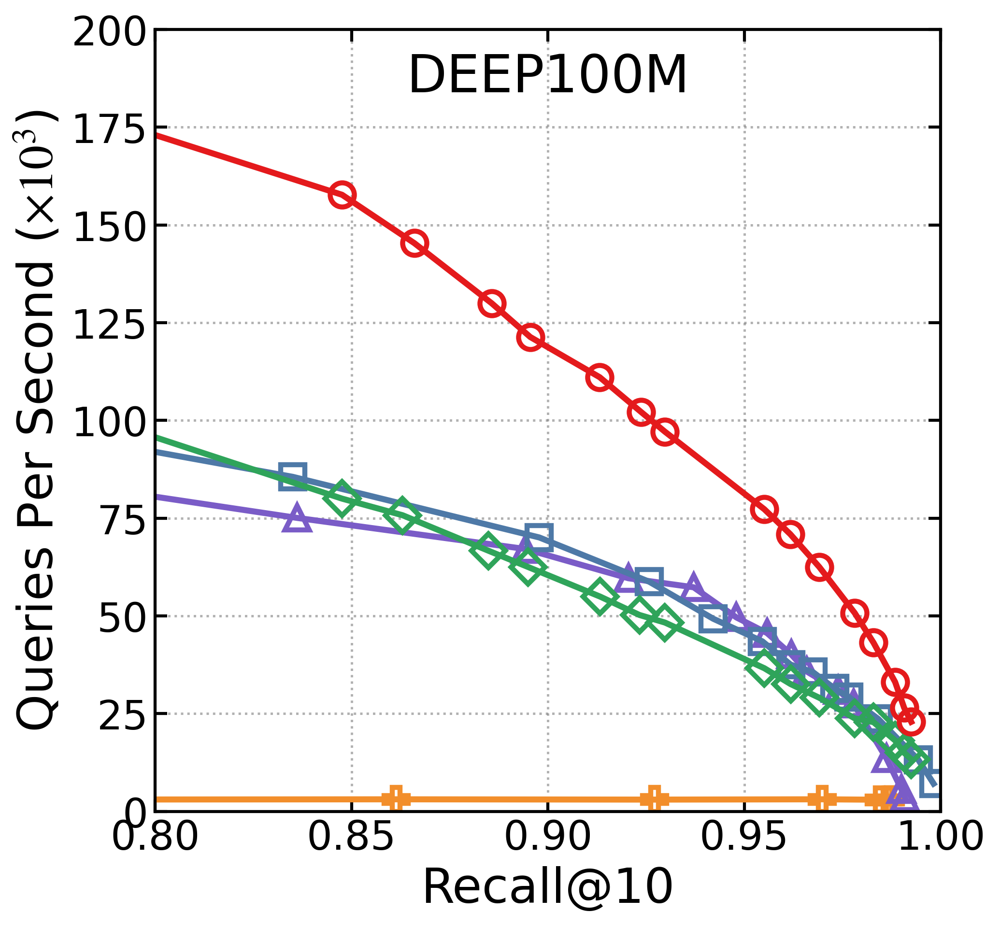
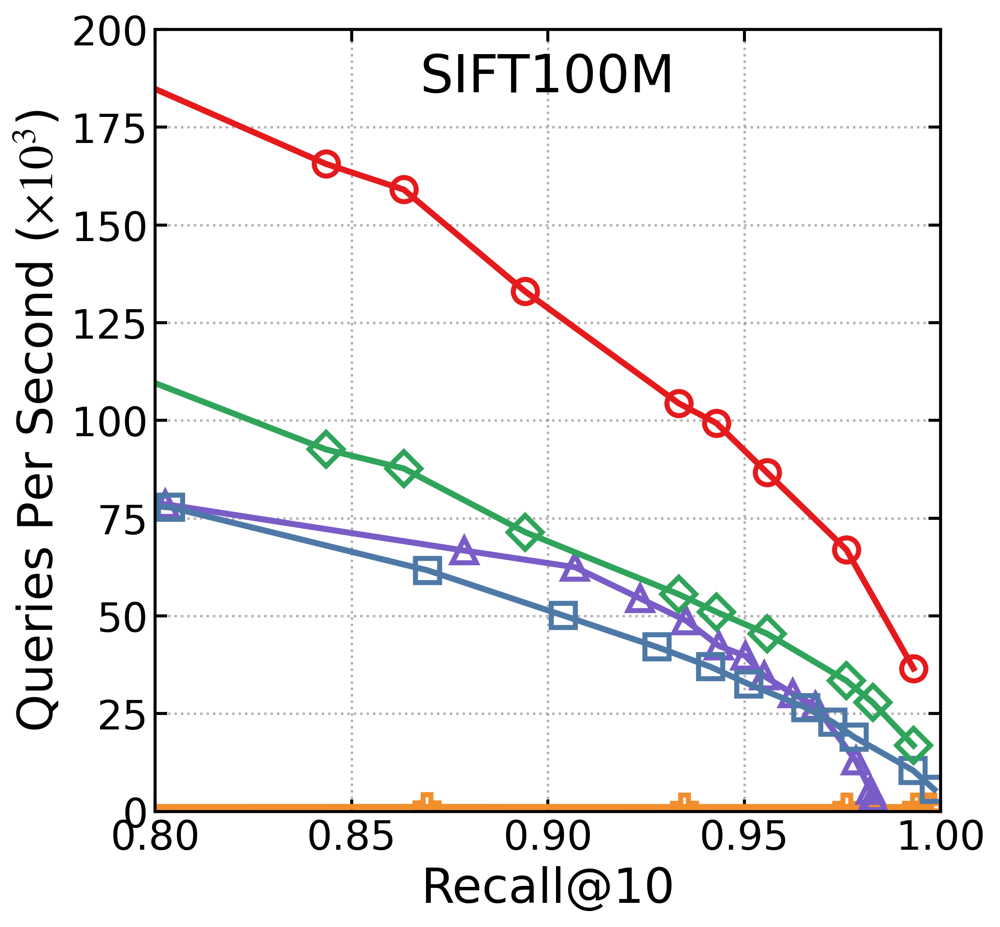
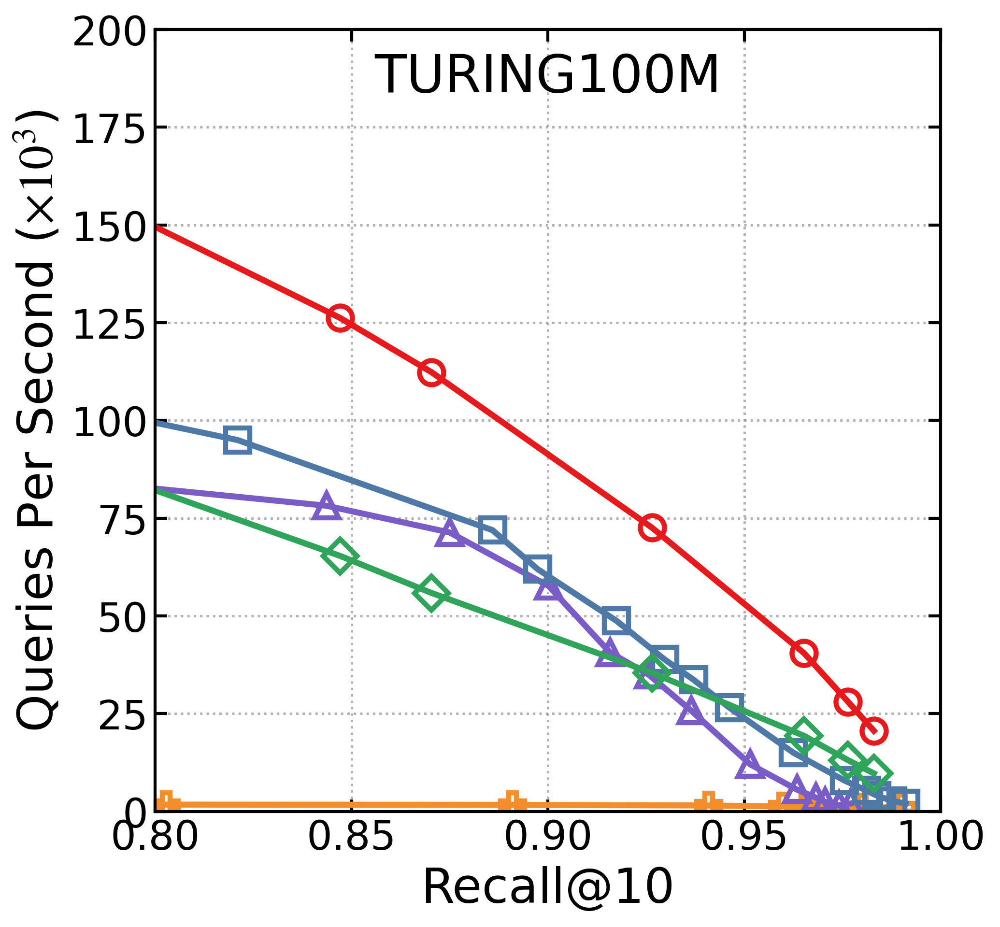
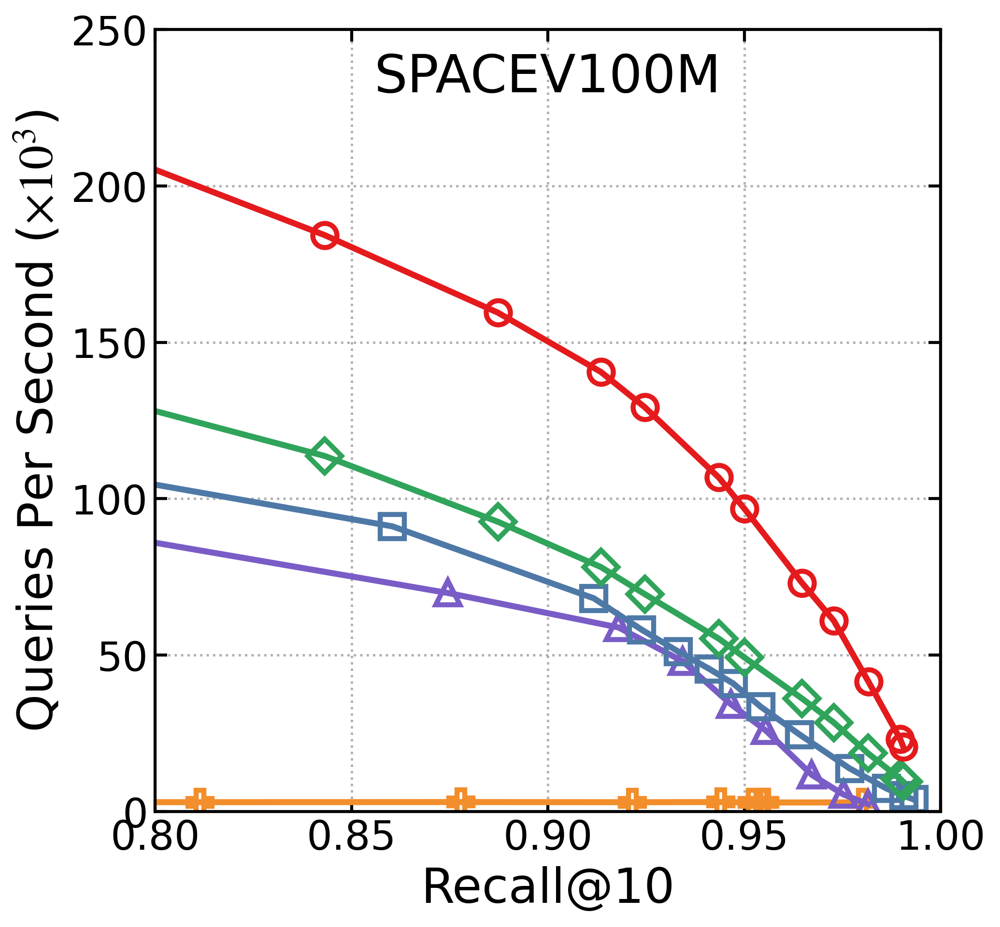
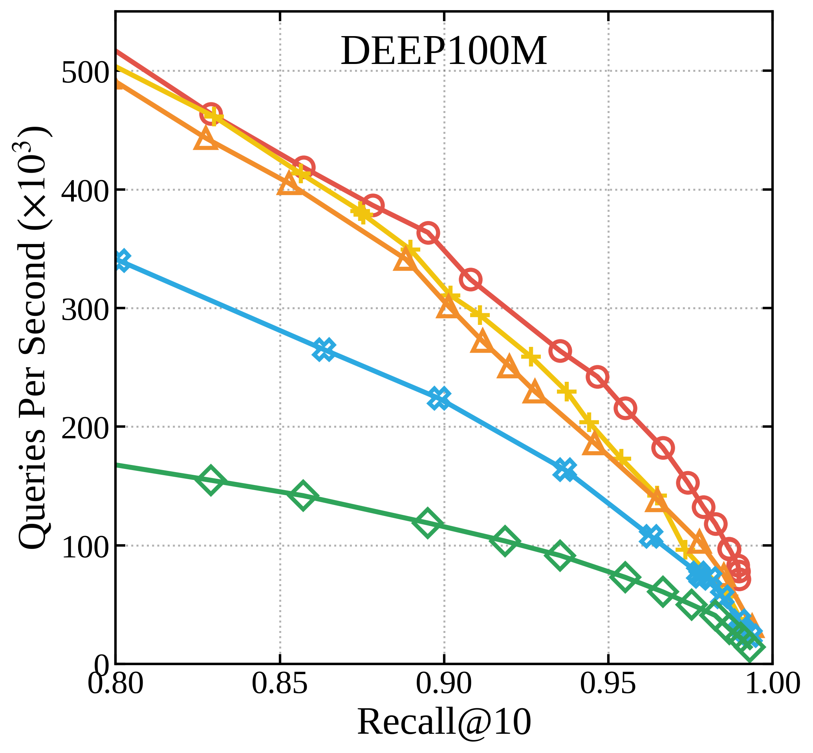
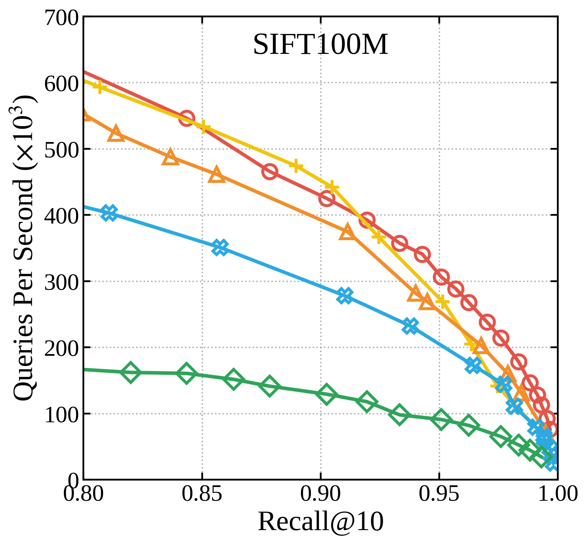
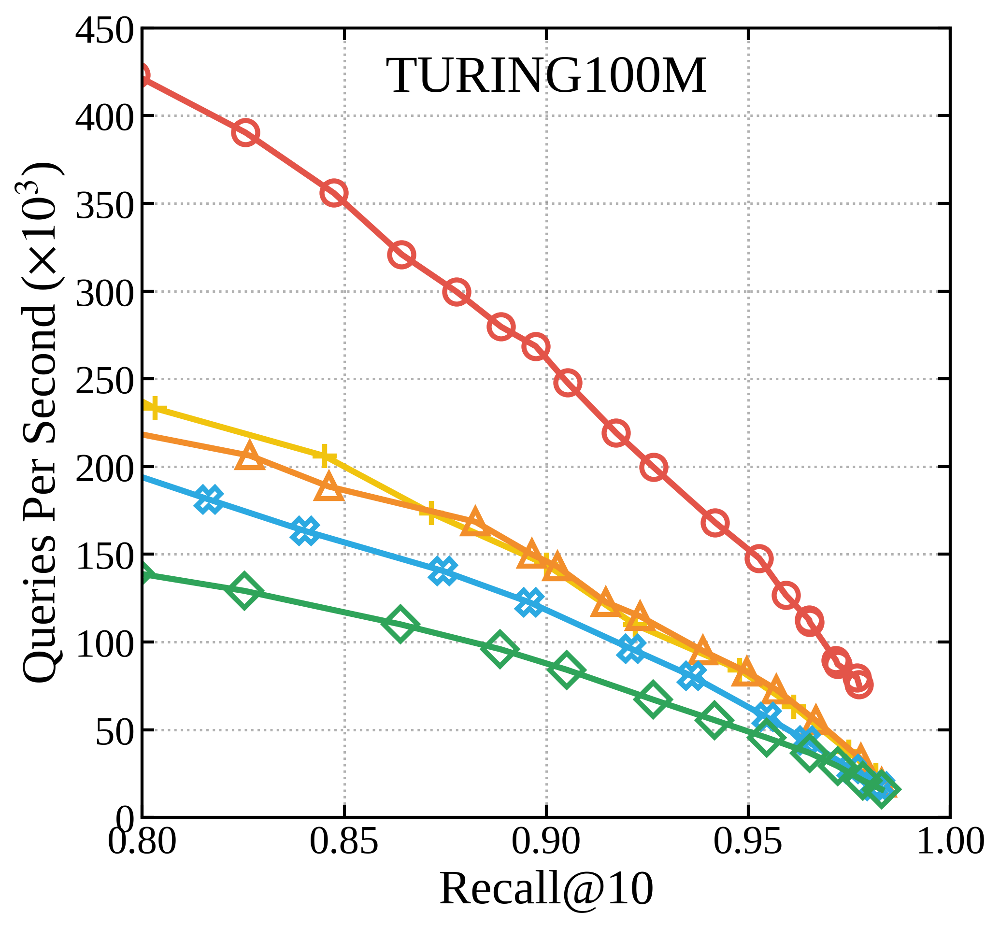
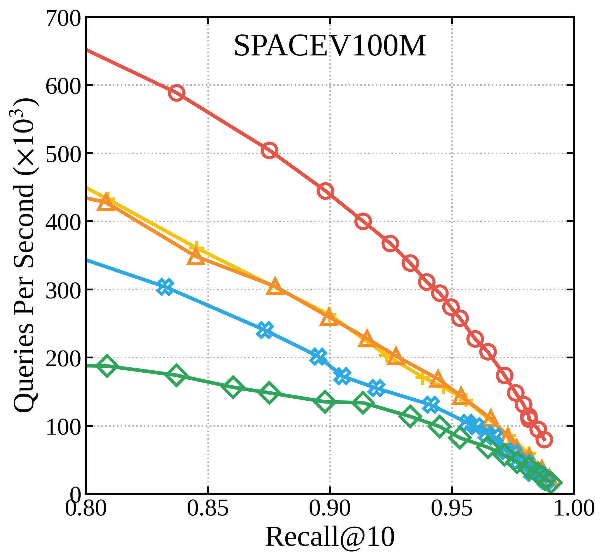

## Introduction

This project shares the Pipelined Heterogeneous Multi-GPU Search
(PHM Search) in C++. This method allows both the raw vectors and the graph
index to be kept in CPU memory. The vectors and the graph entries are loaded
into device memory when they are traversed by the queries. It, therefore,
overcomes the device memory capacity constraint that the most GPU-based NN
search methods face. Moreover, it also allows the search to be carried out on
multiple GPUs in parallel.

## Building

To build PHM Search, ensure you have CUDA Toolkit (12.4+ recommended),
OpenMP, and a C++14 compatible compiler installed.

```bash
$ cd pipnnsearch/src
$ mkdir build && cd build
$ cmake ..
$ make -j
```

## Search on the GPU

To run the search algorithm and measure its performance (QPS and Recall):

```bash
$ cd src/build
$ ./session/path/to/request.txt
```

Parameters:

| Parameter | Description |
| --- | --- |
| `INDEX_PREFIX` | The path and prefix of the pre-built index files. |
| `QUERY_FILE` | Path to the query data file (binary). |
| `GT_FILE` | Path to the Ground Truth file (for recall calculation). |
| `NUM_QUERIES` | Total number of queries to be executed. |
| `L` | Worklist length used by the search. |
| `WORKERS` | Number of CPU workers. |
| `THREADS` | Number of CPU threads assigned to each worker. |
| `FIXED_CARDS` | Number of GPUs when adaptive routing is disabled. |

Example:

```bash
$ ./session request.txt
```

## Experimental Results

We evaluated the performance of our method on several standard benchmark datasets.

### Single-GPU Performance
<div align="center">
  
  <div style="margin-top: -5px;"></div> 
  
  
  
  
</div>


### Multi-GPU Performance
<div align="center">
  
  <div style="margin-top: -5px;"></div>
  
  
  
  
</div>

## Authors

The codes are fully implemented by Ben Zhang from Xiamen University.
